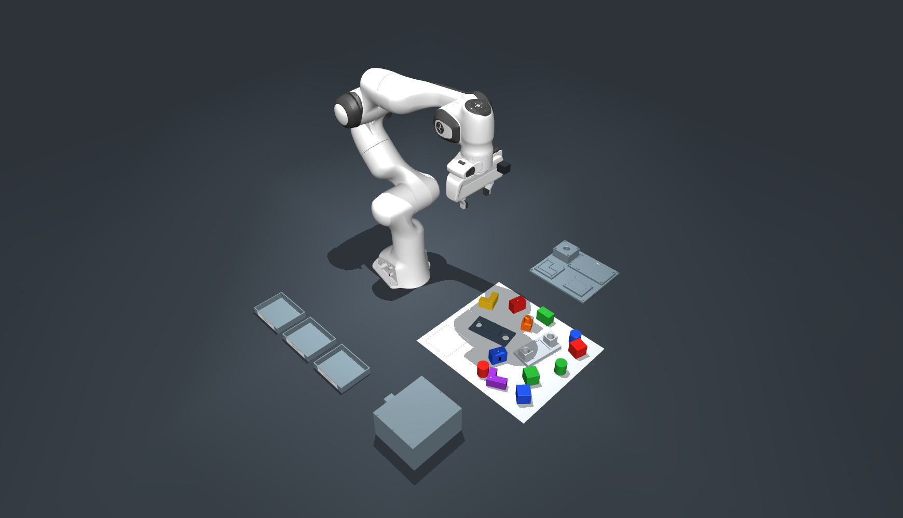

# Robotics 2 winter term 26/27 group challenge

ROS 2 Jazzy on Ubuntu 24.04, with a Franka Emika **Panda**, a physical gripper, MuJoCo, MoveIt 2 and RViz. This repository provides the simulator and its interfaces. Implement your own perception, planning and task execution in `workspace/src/`.

Read [CHALLENGE.md](CHALLENGE.md) or the [illustrated challenge description](assets/challenge-description.pdf) for the six tasks, workspace labels and completion rules. The tasks form one continuous run. No workpiece poses are supplied, including in Level 1.



*Example starting layout in the MuJoCo challenge scene. The workpiece arrangement depends on the seed.*

## Installation

Use a Linux x86-64 host, preferably Ubuntu 24.04. MuJoCo and RViz need an X11 or XWayland desktop. The image includes ROS 2 Jazzy and the simulation dependencies. Allow about 15 GB if building from source. The RGB-D cameras need OpenGL even when running without windows.

Clone or unpack this repository and run the host commands from its root directory. Choose one of the two installation paths below.

### Docker Compose on Linux

Use local Docker Engine with the Compose plugin and default UID/GID mapping. Install the Buildx plugin for source builds. Run these checks from your normal account. The graphical launcher uses `python3`, `xauth`, and the display socket of your Linux desktop. [Docker Engine installation on Ubuntu](https://docs.docker.com/engine/install/ubuntu/)

```bash
sudo apt install python3 xauth
docker info
docker compose version
```

Load the Docker archive from the course downloads. If the course supplies `SHA256SUMS`, run `sha256sum -c --ignore-missing SHA256SUMS` in the download directory first. [Docker image load](https://docs.docker.com/reference/cli/docker/image/load/)

```bash
docker image load -i /path/to/robotics2-panda-student-jazzy.docker.tar.gz
```

To build from source, run this command from the repository root. Compose uses the included `container/Containerfile`. [Docker Compose build reference](https://docs.docker.com/reference/cli/docker/compose/build/)

```bash
docker compose build
```

### Podman

Install rootless Podman with the `crun` runtime. On Ubuntu, run the following commands.

```bash
sudo apt update
sudo apt install podman crun xauth mesa-utils python3
```

Check the host setup, then build the image or load the course archive.

```bash
./tools/panda doctor
./tools/panda build
```

To use the prebuilt image, run the following command.

```bash
./tools/panda load /path/to/robotics2-panda-student-jazzy.oci.tar
```

Both engines use the tag `localhost/robotics2-panda:student-jazzy`. The prebuilt image gives everyone the same dependencies. Source builds need network access and rely on the continued availability of the versions in `versions.lock.yaml`. The image records the resolved Debian packages in `/opt/panda/packages.lock`.

## Start with the empty workbench

Practise arm and gripper control in the standard simulation before attempting the challenge.

1. From the repository root, launch the empty workbench and leave that terminal running. Use the command for your engine.

   ```bash
   ./tools/panda docker-gui  # Docker Compose
   ./tools/panda sim         # Podman
   ```

2. Open a second terminal in the repository and enter the running container. Use the command for the same engine.

   ```bash
   docker compose exec sim /opt/panda/entrypoint.sh bash  # Docker Compose
   ./tools/panda exec bash                              # Podman
   ```

3. Run the remaining commands inside that shell. Check readiness and wait until the message shows `data: true`. If it shows `false`, run the check again after startup finishes.

   ```bash
   ros2 topic echo /panda/simulation/ready std_msgs/msg/Bool --once \
     --qos-durability transient_local --qos-reliability reliable
   ```

4. Send a five-second arm trajectory. From the initial pose, the first joint turns by about 0.10 radians. The command prints `Target reached` when the controller completes the motion.

   ```bash
   ros2 run panda_bringup joint_goal \
     0.10 -0.785398 0.0 -2.356194 0.0 1.570796 0.785398 --duration 5
   ```

5. Narrow the gripper to a 20 mm opening, then reopen it to 80 mm. Watch the fingers in MuJoCo and check that both actions report `success: true`.

   ```bash
   ros2 action send_goal /panda/panda_gripper/move franka_msgs/action/Move \
     '{width: 0.02, speed: 0.03}'
   ros2 action send_goal /panda/panda_gripper/move franka_msgs/action/Move \
     '{width: 0.08, speed: 0.05}'
   ```

Once you can move the arm and gripper reliably, switch to the reference challenge. The sections below explain the interfaces you can use in your application. [Arm control](#arm-control) · [Gripper control](#gripper-control)

## Three environments

Run one environment at a time. MuJoCo and RViz open as desktop windows; MoveIt starts with them.

| Podman command | Compose `PANDA_SCENE` | Environment |
| --- | --- | --- |
| `./tools/panda sim` | `simulation` | Empty workbench with the Panda, hand and flat surface. |
| `./tools/panda competition` | `competition` | Complete challenge with reference seed `0`. |
| `./tools/panda competition-randomized` | `competition_randomized` | Complete challenge with a fresh randomized arrangement at launch. |

### Launch with Docker Compose

For a headless run, prepare the workspace and use Compose directly. The cameras use Mesa software rendering in this mode. Choose one `up` command at a time.

```bash
mkdir -p workspace/src logs
export PANDA_UID="$(id -u)" PANDA_GID="$(id -g)"

docker compose up                                              # Empty workbench
PANDA_SCENE=competition docker compose up                       # Reference challenge
PANDA_SCENE=competition_randomized PANDA_SEED=42 docker compose up
```

For MuJoCo and RViz windows, run the graphical launcher from your Linux desktop. It creates the temporary Xauthority file, selects the available Mesa GPU devices, and starts the same Compose service.

```bash
PANDA_SCENE=competition_randomized PANDA_SEED=42 ./tools/panda docker-gui
```

Omit `PANDA_SEED` to use the scene's default. To pass extra launch options, set `PANDA_LAUNCH_ARGS` to a space-separated list such as `'wrist_camera:=false camera_rate:=3'` before either launch command.

From a second terminal in the repository, open a shell in the running service. The entrypoint loads ROS and your built workspace. Run the `ros2` commands from this README in that shell by dropping the `./tools/panda exec` prefix. Stop with Ctrl+C or `docker compose down`. [Docker Compose quickstart](https://docs.docker.com/compose/gettingstarted/)

```bash
docker compose exec sim /opt/panda/entrypoint.sh bash
ros2 topic echo /panda/simulation/ready std_msgs/msg/Bool --once \
  --qos-durability transient_local --qos-reliability reliable
```

### Launch options and readiness

With Podman, use a reproducible training seed:

```bash
./tools/panda competition-randomized seed:=42
```

Reference and randomized modes share the same models, fixtures, tasks and placement rules. An identical explicit seed produces the same initial arrangement in either mode. Randomization occurs once at launch; parts then move through physics. There are fifteen movable parts: fourteen on A0 and the D-shaped peg inside the closed drawer. Do not restart or reset between challenge levels.

Useful launch options:

```bash
# No desktop windows; keep both RGB-D streams and MoveIt.
./tools/panda competition-randomized seed:=42 headless:=true use_rviz:=false

# Minimal robot-only practice without MoveIt or windows.
./tools/panda sim headless:=true use_rviz:=false use_moveit:=false

# Begin paused after controllers are ready.
./tools/panda competition start_paused:=true

# Select either camera, or disable rendering for control-only practice.
./tools/panda competition wrist_camera:=false
./tools/panda competition external_camera:=false
./tools/panda competition camera:=false

# List launch arguments without starting an environment.
./tools/panda shell --headless
ros2 launch panda_bringup competition_randomized.launch.py --show-args
exit
```

Inside a container the corresponding launch files are `simulation.launch.py`, `competition.launch.py` and `competition_randomized.launch.py` in `panda_bringup`.

Wait for the startup barrier before issuing commands. Run these checks from a second host terminal with Podman, or run the `ros2` commands in the Docker shell above.

```bash
./tools/panda exec ros2 topic echo /panda/simulation/ready std_msgs/msg/Bool --once \
  --qos-durability transient_local --qos-reliability reliable
./tools/panda exec ros2 control list_controllers -c /panda/controller_manager
```

Readiness must be `true`; `joint_state_broadcaster` and `panda_arm_controller` must be `active`. Physics is gated until controller startup completes. Shut down with Ctrl+C in the launch terminal, or:

```bash
./tools/panda stop
```

## Develop your application

The host directory `workspace/` is mounted at `/workspaces/student`. Your source, build and install outputs persist after the simulator exits. `logs/` contains ROS logs. Simulator runtime files remain inside the disposable container.

With an environment running, open a shell with `./tools/panda exec bash` for Podman or the `docker compose exec` command above. Then run the following inside the container.

```bash
cd /workspaces/student
ros2 pkg create --build-type ament_python my_robotics2_team --dependencies rclpy
colcon build --symlink-install
source install/setup.bash
# Run your own node or launch file here.
exit
```

Every new `./tools/panda exec ...` loads ROS, the simulator packages and your workspace overlay if you have built it. An already open shell must source the overlay again after building. Use `./tools/panda shell --headless` for development without starting the simulator. It uses the same container name, so stop the environment first.

Set `use_sim_time:=true` on your own nodes. All positions and dimensions use SI units: radians, metres and seconds. Use the timestamps in camera messages when looking up TF.

OpenCV (`cv2`), `cv_bridge`, NumPy and `tf2_geometry_msgs` are installed for perception and coordinate transforms. Add your own Python dependencies in a workspace virtual environment with `--system-site-packages` when needed; preserve the provided ROS and NumPy dependencies.

## Arm control

Default namespace: `/panda`. Inspect the interfaces:

```bash
./tools/panda exec ros2 topic list
./tools/panda exec ros2 action list -t
./tools/panda exec ros2 topic echo /panda/joint_states --once
```

Joint states may arrive as separate arm and finger messages. Merge values **by joint name**, rather than assuming one message contains all joints. Arm names are `panda_joint1` through `panda_joint7`.

The joint trajectory controller accepts:

| Interface | Type |
| --- | --- |
| `/panda/panda_arm_controller/joint_trajectory` | `trajectory_msgs/msg/JointTrajectory` topic |
| `/panda/panda_arm_controller/follow_joint_trajectory` | `control_msgs/action/FollowJointTrajectory` action |
| `/panda/panda_arm_controller/controller_state` | Controller feedback topic |

Use the **empty environment** for these small examples. Direct trajectories interpolate joint positions; they do not check collisions or plan around the workspace. Use MoveIt for collision-aware paths and add collision geometry from your own object estimates.

Send a small five-second motion near the initial configuration:

```bash
./tools/panda exec ros2 topic pub --once \
  /panda/panda_arm_controller/joint_trajectory trajectory_msgs/msg/JointTrajectory \
  '{joint_names: [panda_joint1, panda_joint2, panda_joint3, panda_joint4, panda_joint5, panda_joint6, panda_joint7], points: [{positions: [0.10, -0.785398, 0.0, -2.356194, 0.0, 1.570796, 0.785398], velocities: [0.0, 0.0, 0.0, 0.0, 0.0, 0.0, 0.0], time_from_start: {sec: 5}}]}'
```

Prefer an action in your application so that you can monitor feedback, cancellation and the result. This example returns to the initial configuration:

```bash
./tools/panda exec ros2 action send_goal --feedback \
  /panda/panda_arm_controller/follow_joint_trajectory control_msgs/action/FollowJointTrajectory \
  '{trajectory: {joint_names: [panda_joint1, panda_joint2, panda_joint3, panda_joint4, panda_joint5, panda_joint6, panda_joint7], points: [{positions: [0.0, -0.785398, 0.0, -2.356194, 0.0, 1.570796, 0.785398], velocities: [0.0, 0.0, 0.0, 0.0, 0.0, 0.0, 0.0], time_from_start: {sec: 5}}]}}'
```

The `joint_goal` command in the walkthrough uses the same action for a single target. [Start with the empty workbench](#start-with-the-empty-workbench)

## Gripper control

The hand exposes Franka-compatible action names. `width` is the **total opening between the fingers** in metres, from `0.0` to `0.08`; `speed` is in metres per second and `force` in newtons. There is no artificial attachment: objects are held by contact and friction.

```bash
# Open.
./tools/panda exec ros2 action send_goal --feedback \
  /panda/panda_gripper/move franka_msgs/action/Move '{width: 0.08, speed: 0.05}'

# Move to a 20 mm opening. Use move for positioning, grasp for holding a part.
./tools/panda exec ros2 action send_goal --feedback \
  /panda/panda_gripper/move franka_msgs/action/Move '{width: 0.02, speed: 0.03}'

# Example grasp request for an already aligned 40 mm part; this is not a pick routine.
./tools/panda exec ros2 action send_goal --feedback \
  /panda/panda_gripper/grasp franka_msgs/action/Grasp \
  '{width: 0.04, speed: 0.03, force: 40.0, epsilon: {inner: 0.005, outer: 0.005}}'

# Stop the hand, or perform homing with the hand clear of objects.
./tools/panda exec ros2 service call /panda/panda_gripper/stop std_srvs/srv/Trigger '{}'
./tools/panda exec ros2 action send_goal \
  /panda/panda_gripper/homing franka_msgs/action/Homing '{}'
```

Check both the action terminal status and its `success` result. A grasp request without a part between the fingers should fail. Force is a simulation control parameter, not a calibrated physical force sensor.

A standard interface is also available at `/panda/panda_gripper/gripper_action` (`control_msgs/action/GripperCommand`). Its `command.position` is **one finger's travel**, half the total opening: `0.04` means fully open. `max_effort: 0.0` selects position movement; a positive value selects grasp mode. Do not send competing goals through both interfaces.

```bash
./tools/panda exec ros2 action send_goal \
  /panda/panda_gripper/gripper_action control_msgs/action/GripperCommand \
  '{command: {position: 0.04, max_effort: 0.0}}'
```

The topics and Franka action types support later transfer to the matching Panda hardware stack. Real hardware requires instructor setup, calibration and safety validation.

## MoveIt and RViz

The RViz MotionPlanning panel uses planning group `panda_arm` and TCP `panda_hand_tcp`. Select the `ready` named state, or set a target using the interactive marker, then **Plan** and inspect the path before **Execute**. The `panda_hand` group has `open` and `close` states. Robot state, the floor, fixed fixtures and camera collision geometry are available to MoveIt.

Movable workpieces and the moving drawer are **not** automatically added or updated using simulator truth. Estimate their state and add/update their collision geometry through the normal MoveIt planning scene interface. A planning attachment records a physical grasp for planning; it does not attach an object in MuJoCo.

## Cameras and transforms

Challenge modes provide an external RGB-D camera overlooking the scene and a wrist-mounted RGB-D camera. The current simulated optical profiles correspond to an external D435 and a wrist D405; rendering provides ideal images and clipped depth, without a full sensor noise model. Either camera or both may be used.

| Data | External | Wrist |
| --- | --- | --- |
| RGB | `/panda/camera/color/image_raw` | `/panda/wrist_camera/color/image_raw` |
| Depth | `/panda/camera/aligned_depth_to_color/image_raw` | `/panda/wrist_camera/aligned_depth_to_color/image_raw` |
| Calibration | `/panda/camera/color/camera_info` | `/panda/wrist_camera/color/camera_info` |
| Optical frame | `workspace_camera_optical_frame` | `wrist_camera_optical_frame` |

Both streams default to 1280 × 720 at 5 Hz. RGB uses `rgb8`; depth uses `16UC1` in **millimetres**, with zero for invalid/out-of-range pixels. External depth range is 0.28–3.0 m; wrist depth range is 0.10–0.50 m. Read the actual intrinsics from `CameraInfo`. Camera optical axes follow ROS conventions (+X right, +Y down, +Z forward). Images and depth are aligned to the same simulated camera projection.

Matching depth calibration is also on each camera's `aligned_depth_to_color/camera_info`. The external-only legacy aliases `camera/camera_info` and `camera/depth/image_raw` remain available; that legacy depth topic uses `32FC1` **metres**, unlike the recommended aligned-depth topics above.

TF is on `/tf` and `/tf_static`; the fixed frame is `world`. Robot and camera transforms are published. There are no dynamic workpiece transforms, pose topics or supplied initial cube poses. Fixed equipment geometry and coordinates are public. Camera rate can be changed with `camera_rate:=5.0` (allowed range: greater than zero, up to 30 Hz); higher rates increase GPU load.

## Pause, reset and repeat during practice

These controls are for practice between attempts. A competition attempt proceeds through all six levels without a reset.

```bash
# Pause and resume.
./tools/panda exec ros2 service call /panda/mujoco_ros2_control_node/set_pause \
  mujoco_ros2_control_msgs/srv/SetPause '{paused: true}'
./tools/panda exec ros2 service call /panda/mujoco_ros2_control_node/set_pause \
  mujoco_ros2_control_msgs/srv/SetPause '{paused: false}'

# Managed reset: cancels the arm goal, restores the launch state and ends PAUSED.
./tools/panda exec ros2 service call /panda/simulation/reset std_srvs/srv/Trigger '{}'
# Resume explicitly after a successful reset.
./tools/panda exec ros2 service call /panda/mujoco_ros2_control_node/set_pause \
  mujoco_ros2_control_msgs/srv/SetPause '{paused: false}'
```

A reset restores the **same** initial arrangement. Stop and relaunch with a different seed for another training arrangement. MuJoCo Backspace also resets; prefer the managed ROS reset while controlling the arm. Empty-scene practice has no loose objects.

## Training and assessment

Training seeds are public and repeatable. Use them to evaluate your method, not as a lookup key for object poses. During a challenge, workpiece state must come from the permitted camera observations and your action history. Robot state, calibration, object models and fixed fixture geometry are available. The repository supplies no task solver or reference trajectories.

A simulator running on a machine you control cannot conceal its generated scene or seed from its owner. The final unseen seed is therefore chosen and run by the instructor in a controlled evaluation environment; it is not included in this repository or image. Submit an application that uses the documented ROS interfaces and does not depend on simulator files, state editing, privileged state feeds or seed-to-pose lookup tables. Human intervention and resets during a scored attempt follow the course rules.